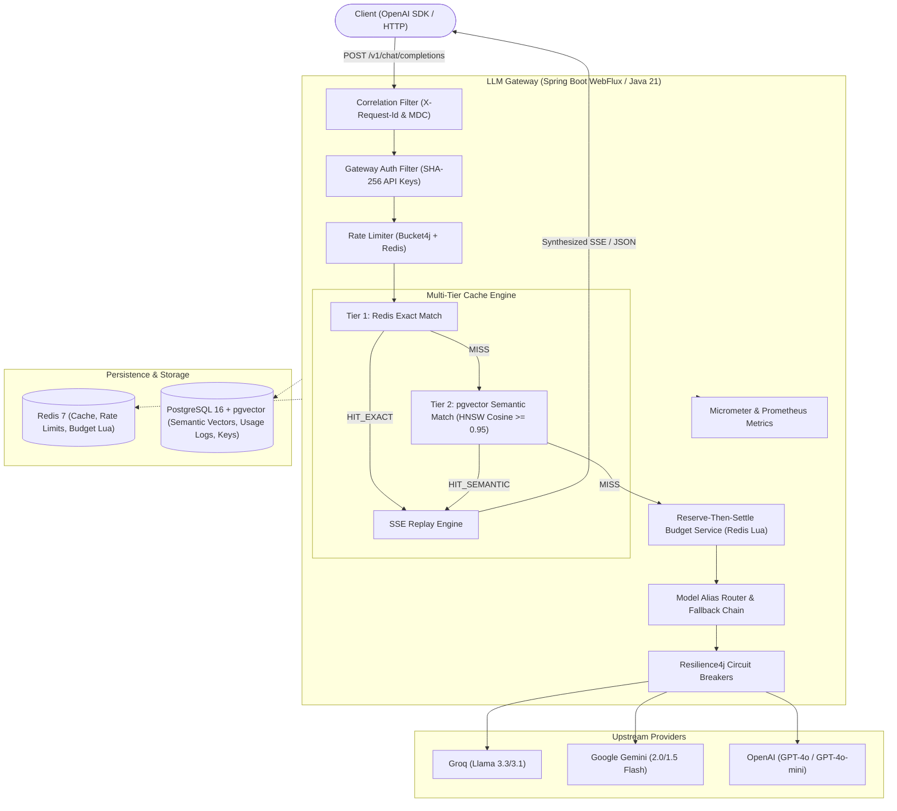
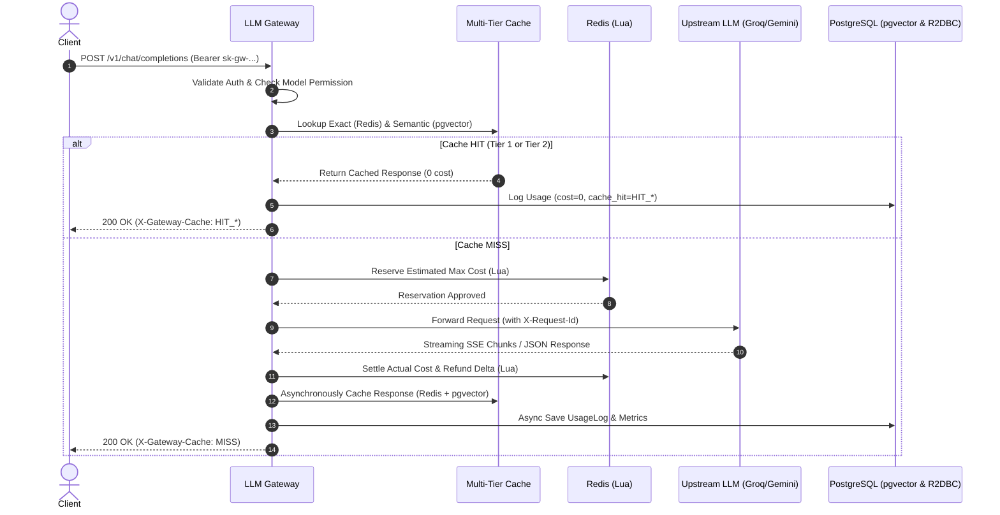

# LLM Gateway

A production-grade, reactive LLM Gateway built with **Java 21 (LTS)** and **Spring Boot WebFlux (Reactor Netty)**. Exposes an OpenAI-compatible API with intelligent multi-tier caching, dynamic alias routing, atomic budget management, distributed rate limiting, circuit breaker failovers, and end-to-end Prometheus observability.

---

## Architecture Overview



---

## Core Features

- **OpenAI-Compatible API**: Transparent drop-in replacement (`POST /v1/chat/completions`, `GET /v1/models`).
- **Reactive Streaming Passthrough**: Zero-buffering SSE streaming with backpressure control and side-channel token extraction via Reactor operators (`doOnNext`, `doOnCancel`, `doOnError`).
- **Two-Tier Multi-Tier Caching**:
  - **Tier 1 (Exact Match)**: Redis key `cache:exact:{sha256(model + messages + params)}` with sub-10ms response time.
  - **Tier 2 (Semantic Match)**: 768-dimensional vector embeddings with PostgreSQL `pgvector` HNSW index, cosine similarity $\ge 0.95$, scoped to `sha256(model + ":" + systemPrompt)` with temperature gating ($\le 0.2$).
  - **SSE Replay Engine**: Replays cached responses into realistic SSE chunk streams ending with `[DONE]`.
  - **Zero Billing on Cache Hits**: 0 micro-USD billed for cached queries.
- **Provider Abstraction & Dynamic Routing**: YAML-driven routing aliases (`fast-chat`, `smart-chat`, `gemini-flash`, `gpt-4o-mini`).
- **Resilience & Pre-Stream Fallback Chains**: Circuit breakers per provider using Resilience4j Reactor operators. Automatic transparent failover on 5xx/429/timeout before the first byte is written. Provider locking after first token emission.
- **Reserve-Then-Settle Budgeting**: Atomic pre-flight cost reservation and post-completion settlement via Redis Lua scripts and PostgreSQL R2DBC.
- **Distributed Rate Limiting**: Distributed token bucket rate limiting via Bucket4j Lettuce reactive connection.
- **Observability & Prometheus Metrics**:
  - Micrometer metrics: `llm_gateway_requests_total`, `llm_gateway_time_to_first_token_seconds`, `llm_gateway_latency_seconds`, `llm_gateway_tokens_total`, `llm_gateway_cost_micro_usd_total`.
  - Circuit breaker states (`closed`, `open`, `half_open`) exposed to `/actuator/prometheus`.
  - Distributed correlation: `X-Request-Id` propagated across MDC, Reactor Context, and downstream provider HTTP calls.

---

## Tech Stack

| Component | Technology |
| :--- | :--- |
| **Runtime & Language** | Java 21 (LTS), Generational ZGC (`-XX:+UseZGC -XX:+ZGenerational`) |
| **Framework** | Spring Boot 4.1.x / WebFlux (Reactor Netty) |
| **Relational Database** | PostgreSQL 16 with `pgvector` extension |
| **Database Access** | Spring Data R2DBC + `DatabaseClient` (non-blocking) |
| **Database Migrations** | Flyway (JDBC startup runner) |
| **Distributed Cache & State** | Redis 7 (Reactive Lettuce driver) |
| **Rate Limiter** | Bucket4j Redis Lettuce |
| **Circuit Breakers** | Resilience4j Reactor |
| **Metrics & Telemetry** | Micrometer, Prometheus, Spring Boot Actuator |
| **Testing** | JUnit 5, Reactor Test, WireMock Standalone, Testcontainers |

---

## Sequence: Request Lifecycle & Budgeting



---

## Quickstart

### 1. Start Infrastructure via Docker Compose
```bash
docker compose up -d postgres redis
```
*Starts PostgreSQL 16 on port `5433` with `pgvector` and Redis on port `6379`.*

### 2. Build the Application
```bash
export JAVA_HOME=/opt/homebrew/opt/openjdk@21
export PATH=$JAVA_HOME/bin:$PATH
mvn clean compile
```

### 3. Run the Automated Test Suite (27+ Tests)
```bash
mvn test
```

### 4. Run the Gateway Application
```bash
mvn spring-boot:run
```
*Server starts on `http://localhost:8080`.*

---

## Running Full Stack in Docker

Build and launch the complete stack (Postgres + pgvector, Redis, and Gateway) with multi-stage Docker build:
```bash
docker compose up --build
```

Health check endpoint:
```bash
curl http://localhost:8080/actuator/health
```

---

## API Usage Guide

### 1. API Key Provisioning (Admin API)

#### Create a Key
```bash
curl -X POST http://localhost:8080/v1/admin/keys \
  -H "Content-Type: application/json" \
  -H "X-Admin-Master-Key: dev-admin-key" \
  -d '{
    "name": "Production Service Key",
    "allowedModels": ["fast-chat", "smart-chat"],
    "budgetMicroUsd": 10000000,
    "rateLimitRpm": 120
  }'
```
*Returns the full raw key (`sk-gw-...`) **once** upon creation.*

#### List Keys (Prefix Only)
```bash
curl http://localhost:8080/v1/admin/keys \
  -H "X-Admin-Master-Key: dev-admin-key"
```

#### Revoke a Key
```bash
curl -X DELETE http://localhost:8080/v1/admin/keys/{keyId} \
  -H "X-Admin-Master-Key: dev-admin-key"
```

---

### 2. Chat Completions (`POST /v1/chat/completions`)

#### Non-Streaming Request
```bash
curl -X POST http://localhost:8080/v1/chat/completions \
  -H "Content-Type: application/json" \
  -H "Authorization: Bearer <your-api-key>" \
  -d '{
    "model": "fast-chat",
    "messages": [{"role": "user", "content": "What is the capital of France?"}],
    "temperature": 0.1,
    "stream": false
  }'
```

#### Streaming SSE Request
```bash
curl -N -X POST http://localhost:8080/v1/chat/completions \
  -H "Content-Type: application/json" \
  -H "Authorization: Bearer <your-api-key>" \
  -d '{
    "model": "fast-chat",
    "messages": [{"role": "user", "content": "Explain reactive programming in two sentences."}],
    "stream": true
  }'
```

#### Bypassing Cache
Pass `X-Gateway-Bypass-Cache: true` to force an upstream model call:
```bash
curl -X POST http://localhost:8080/v1/chat/completions \
  -H "Content-Type: application/json" \
  -H "Authorization: Bearer <your-api-key>" \
  -H "X-Gateway-Bypass-Cache: true" \
  -d '{
    "model": "fast-chat",
    "messages": [{"role": "user", "content": "What is the capital of France?"}]
  }'
```

---

### 3. Usage & Budget Consumption Query
```bash
curl http://localhost:8080/v1/usage \
  -H "Authorization: Bearer <your-api-key>"
```
Example Response:
```json
{
  "api_key_id": "7538d586-13cb-4f1c-9b16-563b7829871f",
  "key_prefix": "sk-gw-89abc",
  "budget_micro_usd": 10000000,
  "spent_micro_usd": 2450,
  "remaining_micro_usd": 9997550,
  "budget_usd": 10.0,
  "spent_usd": 0.00245,
  "remaining_usd": 9.99755,
  "total_requests": 6,
  "total_prompt_tokens": 140,
  "total_completion_tokens": 210,
  "total_tokens": 350
}
```

---

### 4. Observability & Prometheus Metrics
Scrape Prometheus metrics at:
```bash
curl http://localhost:8080/actuator/prometheus
```

Exported Metrics Include:
- `llm_gateway_requests_total{provider="...",model="...",status="...",cache_hit="..."}`
- `llm_gateway_time_to_first_token_seconds{provider="...",model="..."}` (distribution summary)
- `llm_gateway_latency_seconds{provider="...",model="...",status="...",cache_hit="..."}`
- `llm_gateway_tokens_total{type="prompt|completion",provider="...",model="..."}`
- `llm_gateway_cost_micro_usd_total{api_key="...",provider="...",model="..."}`
- `resilience4j_circuitbreaker_state{name="...",state="closed|open|half_open"}`

---

## Benchmarking & Performance Validation

A benchmark script is included to test cold vs. warm cache speedups and load throughput:
```bash
# Run benchmark with Python 3
python3 scripts/benchmark.py --gateway-url http://localhost:8080 --requests 50 --concurrency 10
```
Or via shell script:
```bash
./scripts/benchmark.sh --requests 100 --concurrency 20
```

---

## OpenAI Python SDK Integration

```python
from openai import OpenAI

client = OpenAI(
    base_url="http://localhost:8080/v1",
    api_key="sk-gw-your-api-key"
)

# Standard non-streaming chat completion
response = client.chat.completions.create(
    model="fast-chat",
    messages=[{"role": "user", "content": "Hello LLM Gateway!"}]
)
print(response.choices[0].message.content)

# Streaming SSE chat completion
stream = client.chat.completions.create(
    model="smart-chat",
    messages=[{"role": "user", "content": "Write a 3-line haiku."}],
    stream=True
)
for chunk in stream:
    if chunk.choices and chunk.choices[0].delta.content:
        print(chunk.choices[0].delta.content, end="", flush=True)
print()
```

---

## Continuous Integration (CI/CD)

The GitHub Actions workflow at [`.github/workflows/ci.yml`](file:///Users/adityayadav/Desktop/LLM%20Gateway/.github/workflows/ci.yml) automates:
1. Spin-up of PostgreSQL 16 (pgvector) and Redis 7 containers.
2. JDK 21 build and execution of all 27+ integration tests (`mvn clean verify`).
3. Multi-stage Docker image packaging verification.
