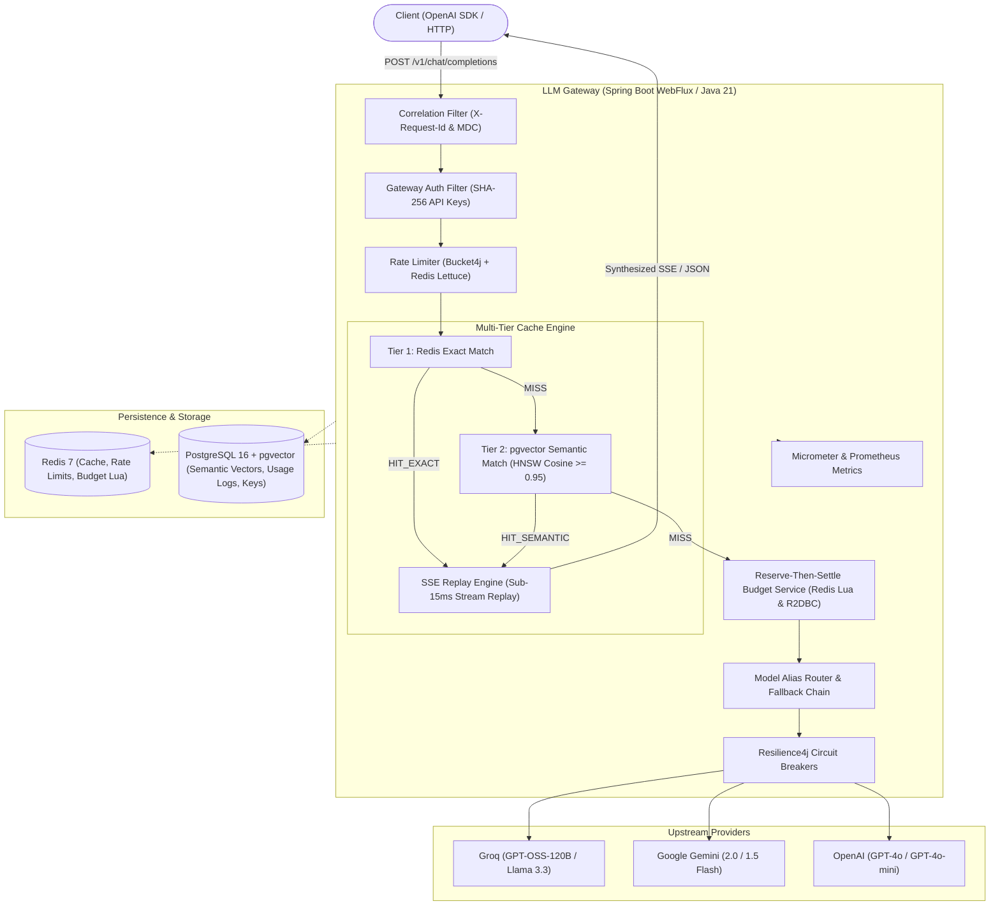

# LLM Gateway

A high-performance, production-grade, reactive LLM Gateway built with **Java 21 (LTS)** and **Spring Boot WebFlux (Reactor Netty)**. Exposes an OpenAI-compatible API featuring two-tier semantic and exact caching, dynamic model alias routing with automatic failovers, atomic budget management (Reserve-then-Settle), distributed rate limiting, and end-to-end Prometheus observability.

---

## Architecture Overview



---

## Detailed Tech Stack & Architecture

| Layer / Component | Technology | Version | Purpose & Architectural Details |
| :--- | :--- | :--- | :--- |
| **Runtime & JVM** | Java LTS | **Java 21** | Modern Java with Generational ZGC (`-XX:+UseZGC -XX:+ZGenerational`) for ultra-low GC pause times under high-concurrency LLM streaming. |
| **Reactive Framework** | Spring Boot WebFlux | **4.1.x** | Non-blocking reactive foundation on **Project Reactor 3.8** and **Reactor Netty 1.3**; zero thread-per-request overhead, native backpressure handling. |
| **Database & Vector Store** | PostgreSQL + `pgvector` | **16.x** | Persistent storage for API keys, usage audit logs, model pricing, and 768-dimensional semantic embeddings indexed with **HNSW (Hierarchical Navigable Small World)** for sub-millisecond approximate nearest neighbor (ANN) cosine distance queries. |
| **Reactive Database Client** | Spring Data R2DBC | **7.0.x** | Pure reactive, non-blocking asynchronous PostgreSQL driver avoiding JDBC connection thread starvation. |
| **Schema Migrations** | Flyway | **10.x** | Versioned, synchronous startup migrations (`V1__init_schema.sql`, `V2__add_groq_gpt_oss_pricing.sql`) ensuring deterministic schema creation before reactive beans initialize. |
| **Distributed Cache & State** | Redis | **7.x (Alpine)** | High-throughput in-memory datastore for Tier 1 exact prompt caching, API key authentication cache, and atomic Redis Lua scripts. |
| **Reactive Redis Driver** | Lettuce | **6.x** | Non-blocking, netty-backed Redis client sharing event loops with WebFlux. |
| **Distributed Rate Limiting** | Bucket4j | **8.10.x** | Distributed Token Bucket rate limiting via `LettuceBasedProxyManager`; enforces strict per-key Requests-Per-Minute (RPM) limits across clustered gateway nodes. |
| **Fault Tolerance & Resilience** | Resilience4j | **2.2.x** | Circuit Breaker pattern with Reactor operators (`transformDeferred`), sliding-window failure rate thresholds, half-open probe states, and automatic upstream failover before the first byte is streamed. |
| **Metrics & Observability** | Micrometer + Prometheus | **Latest** | Native metrics scraping endpoint (`/actuator/prometheus`) tracking request latencies, Time-To-First-Token (TTFT), token counts (prompt & completion), spend in micro-USD, and circuit breaker states. |
| **Serialization & Streaming** | Jackson | **2.18.x** | Streaming JSON serialization/deserialization with custom `@JsonAlias` and `@JsonIgnore` helpers preventing leaked DTO internals to upstream LLMs. |
| **Integration Testing** | JUnit 5 + WireMock + Testcontainers | **Latest** | Comprehensive 28-test test suite testing isolated containers, Mock WireMock upstreams, SSE reactive assertions via `StepVerifier`, and failure scenarios. |

---

## Core Capabilities

### 1. Multi-Tier Caching Engine
- **Tier 1: Redis Exact Match (`HIT_EXACT`)**:
  - Keys are deterministic hashes of: `sha256(model + messages + temperature + topP + maxTokens + stop)`.
  - Sub-15ms response latency with zero LLM API costs.
- **Tier 2: pgvector Semantic Match (`HIT_SEMANTIC`)**:
  - Uses vector embeddings (768 dimensions) via cosine similarity ($\ge 0.95$).
  - Scoped to `sha256(model + ":" + systemPrompt)`.
  - Gated by temperature ($\le 0.2$) so creative/random requests are never falsely matched to cached completions.
- **SSE Stream Replay Engine**:
  - When a client sends `"stream": true` for a prompt that is already cached, the gateway converts the cached completion into standard OpenAI SSE chunks and streams them back in real time.
- **Cache Bypass Header**:
  - Clients can force a fresh generation using `X-Gateway-Bypass-Cache: true`.

### 2. Provider Abstraction & Model Alias Routing
Decouples client models from vendor models through declarative YAML routes:
```yaml
gateway:
  routes:
    fast-chat:
      description: "Ultra-fast low-latency chat"
      targets:
        - provider: groq
          model: openai/gpt-oss-120b
        - provider: gemini
          model: gemini-1.5-flash
    smart-chat:
      description: "High-reasoning smart chat"
      targets:
        - provider: groq
          model: openai/gpt-oss-120b
        - provider: gemini
          model: gemini-1.5-flash
```
* **Pre-stream Failover:** If the primary provider returns a 429, 503, 500, or times out before the first byte is sent, the gateway seamlessly fails over to the next configured target in the chain.
* **Stream Locking:** Once the first token is emitted to the client, the provider target is locked to prevent corrupted or split streaming output.

### 3. Reserve-Then-Settle Budgeting Engine
- Eliminates race conditions in concurrent spend tracking:
  1. **Reserve:** Before calling upstream, the gateway estimates the maximum potential cost based on prompt token count and `max_tokens`, atomically reserving the amount in Redis.
  2. **Call Upstream:** The request executes against the LLM.
  3. **Settle:** Upon completion (or stream termination `[DONE]`), the gateway calculates the exact token cost, charges the actual spend, and refunds the reserved delta back to the key's budget.
  4. **Enforce:** If a key lacks sufficient budget, requests are immediately rejected with `402 Payment Required`.

### 4. Distributed Rate Limiting
- Enforces per-API-key Requests-Per-Minute (`rate_limit_rpm`) using distributed Redis-backed Bucket4j token buckets.
- When the rate limit is exceeded, returns `429 Too Many Requests` with the standard `Retry-After: <seconds>` HTTP header.

### 5. Prometheus Observability & Telemetry
Exposes metrics at `/actuator/prometheus`:
- `llm_gateway_requests_total`: Counter tagged by `provider`, `model`, `status`, and `cache_hit` (`HIT_EXACT`, `HIT_SEMANTIC`, `MISS`).
- `llm_gateway_time_to_first_token_seconds`: Histogram measuring initial token latency.
- `llm_gateway_latency_seconds`: End-to-end request latency distribution.
- `llm_gateway_tokens_total`: Total tokens partitioned by `type` (`prompt`, `completion`).
- `llm_gateway_cost_micro_usd_total`: Cumulative cost billed to API keys in micro-USD ($1\text{ micro-USD} = \$0.000001\text{ USD}$).
- `resilience4j_circuitbreaker_state`: Real-time circuit breaker health per provider (`closed`, `open`, `half_open`).

---

## Configuration & Environment Variables

| Variable | Default | Description |
| :--- | :--- | :--- |
| `DB_HOST` | `localhost` | PostgreSQL host |
| `DB_PORT` | `5433` | PostgreSQL port |
| `DB_NAME` | `llmgateway` | Database name |
| `DB_USER` | `postgres` | Database username |
| `DB_PASSWORD` | `postgrespassword` | Database password |
| `REDIS_HOST` | `localhost` | Redis host |
| `REDIS_PORT` | `6379` | Redis port |
| `GATEWAY_MASTER_KEY`| `dev-admin-key` | Master key for admin endpoints (`/v1/admin/*`) |
| `GROQ_API_KEY` | *(empty)* | Groq API key for upstream Llama & GPT-OSS models |
| `GEMINI_API_KEY` | *(empty)* | Google Gemini API key |
| `OPENAI_API_KEY` | *(empty)* | OpenAI API key |

---

## Quickstart & Local Setup

### 1. Start Infrastructure via Docker Compose
```bash
docker compose up -d postgres redis
```
*Spins up PostgreSQL 16 with `pgvector` on port `5433` and Redis 7 on port `6379`.*

### 2. Build the Application
```bash
export JAVA_HOME=/opt/homebrew/opt/openjdk@21
mvn clean package -DskipTests
```

### 3. Run the Automated Test Suite (28 Integration Tests)
```bash
mvn test
```

### 4. Run the Gateway Application
```bash
export GROQ_API_KEY="gsk_..."
export GATEWAY_MASTER_KEY="dev-admin-key"
java -jar target/llm-gateway-0.0.1-SNAPSHOT.jar
```
*Server starts on `http://localhost:8080`.*

---

## API Usage Guide

### 1. Provision an API Key
```bash
curl -i -X POST http://localhost:8080/v1/admin/keys \
  -H "X-Admin-Master-Key: dev-admin-key" \
  -H "Content-Type: application/json" \
  -d '{
    "name": "My-App-Key",
    "allowed_models": ["fast-chat", "smart-chat"],
    "monthly_budget_usd": 10.0,
    "rate_limit_rpm": 60
  }'
```
*Returns the full raw API key (`sk-gw-...`) once upon creation.*

### 2. Standard Chat Completion (Non-Streaming)
```bash
curl -i -X POST http://localhost:8080/v1/chat/completions \
  -H "Authorization: Bearer $API_KEY" \
  -H "Content-Type: application/json" \
  -d '{
    "model": "fast-chat",
    "messages": [
      {"role": "user", "content": "What is the capital of Japan? Answer in one word."}
    ],
    "temperature": 0.0
  }'
```

### 3. Streaming Chat Completion (SSE)
```bash
curl -N -i -X POST http://localhost:8080/v1/chat/completions \
  -H "Authorization: Bearer $API_KEY" \
  -H "Content-Type: application/json" \
  -d '{
    "model": "fast-chat",
    "stream": true,
    "stream_options": {"include_usage": true},
    "messages": [
      {"role": "user", "content": "Count from 1 to 5, one number per line."}
    ],
    "temperature": 0.0
  }'
```

### 4. Bypassing the Cache
Pass `X-Gateway-Bypass-Cache: true` to force an upstream generation:
```bash
curl -i -X POST http://localhost:8080/v1/chat/completions \
  -H "Authorization: Bearer $API_KEY" \
  -H "X-Gateway-Bypass-Cache: true" \
  -H "Content-Type: application/json" \
  -d '{
    "model": "fast-chat",
    "messages": [
      {"role": "user", "content": "What is the capital of Japan?"}
    ]
  }'
```

### 5. Check Token Usage & Spend Audit
```bash
curl -i -X GET http://localhost:8080/v1/usage \
  -H "Authorization: Bearer $API_KEY"
```

### 6. Prometheus Metrics Scrape
```bash
curl -s http://localhost:8080/actuator/prometheus | grep "llm_gateway"
```

### 7. Revoke an API Key
```bash
curl -i -X DELETE http://localhost:8080/v1/admin/keys/{id} \
  -H "X-Admin-Master-Key: dev-admin-key"
```

---

## Python OpenAI SDK Integration

```python
from openai import OpenAI

client = OpenAI(
    base_url="http://localhost:8080/v1",
    api_key="sk-gw-your-api-key"
)

# Standard non-streaming chat completion
response = client.chat.completions.create(
    model="fast-chat",
    messages=[{"role": "user", "content": "Hello LLM Gateway!"}],
    temperature=0.0
)
print(response.choices[0].message.content)

# Streaming SSE chat completion
stream = client.chat.completions.create(
    model="fast-chat",
    messages=[{"role": "user", "content": "Write a short haiku."}],
    stream=True
)
for chunk in stream:
    if chunk.choices and chunk.choices[0].delta.content:
        print(chunk.choices[0].delta.content, end="", flush=True)
print()
```
